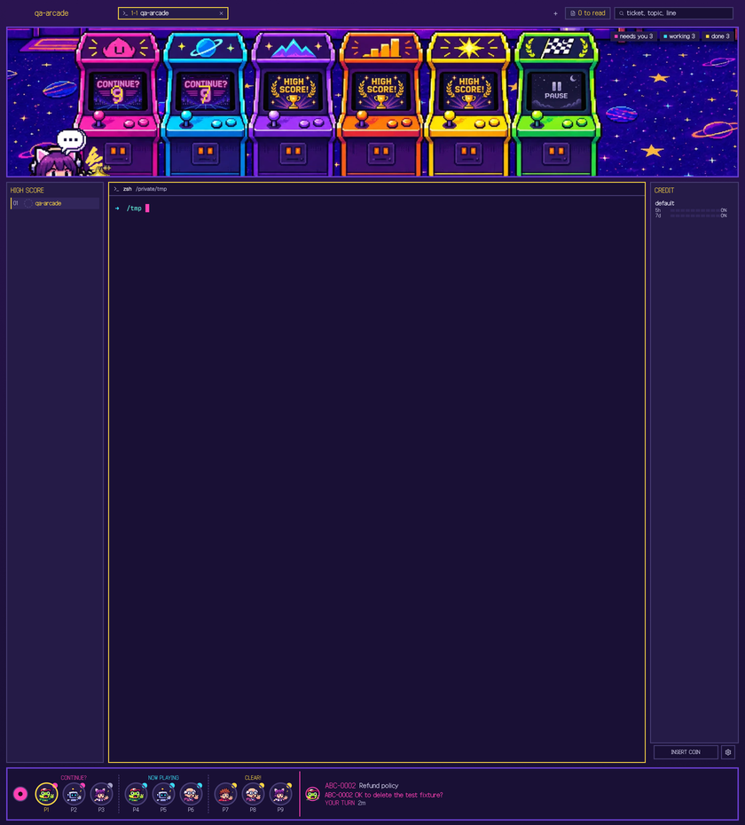

# Arcade Cards

An 80s arcade-in-the-dark layout for [Herdr](https://herdr.dev), cut as the front of one cabinet. Across the top, a marquee bar holds the space name, the tabs as numbered stages, the search field and the unread page count. Below it the marquee shows the arcade at night: six cabinets with one character per session, plus a needs countdown, a PAUSE for a stalled session, a cheering finish and sleepers on the back bench. The middle row puts the terminal in a rounded CRT in the centre, a HIGH SCORE board on the left — each repository a game title, each of its spaces a ranked row of a face, its ticket key and its name — and a CREDIT panel on the right with one usage row per account. The bottom is the control panel: a joystick, then one round button per session with a character's face, its P number and a status lamp (magenta needs you and blinking, cyan working, grey stalled, yellow done, dim once read). CONTINUE? (needs you), NOW PLAYING (working) and CLEAR! (done) run left to right with dashed separators; the selected button takes a yellow border, and the panel's right side describes the selected session (or the first needs-you one) with its face, ticket key, topic, two lines of dialogue, and its state and time; hovering a button raises the full card as a popover. A button click goes to that session, `?` brings up the HOW TO PLAY legend, and ctrl-alt-p hands the keyboard to the panel. Dark navy ground with the cabinet's purple body (`cab` `#2a1450`) fading into it, magenta for needs you, cyan for working, yellow for done and focus, Galmuri pixel fonts, square corners and pixel borders.



## Add it

From this checkout:

```sh
./tools/install.sh
```

The script copies `mods/arcade-cards`, `mods/arcade-scene`, `mods/arcade-rail`, `mods/arcade-accounts`, `mods/arcade-tabs`, `mods/arcade-pane` and `mods/arcade-editor`, plus `layouts/arcade.json` and `themes/arcade.json`, into `${HERDR_APP_HOME:-$HOME/.config/herdr-app}`, makes `cca`, `usage-tap.sh`, `hv` and `hv-open` executable, and runs `herdr-app check` on each mod. It needs no Python.

`arcade-cards` takes four optional props from its layout blocks. `jiraBase` (for example `https://example.atlassian.net/browse/`) and `slackBase` (`https://example.slack.com/archives/`) turn a ticket key and a Slack thread into links in a card's menu; leave either out and its row and hot key are not offered, with the ticket key shown as plain text. `knownRepos` lists the folder prefixes that name a repository (`api-fix-login` is `api`) for sessions outside a `workspaces/` or `.claude/worktrees/` path; it is empty by default. `ticketPrefixes` lists the Jira project prefixes, for example `["ABC"]`; with it those keys also match case-insensitively, so a folder `abc-1408-ai` gives `ABC-1408`, and only those prefixes match. Without it a key must be uppercase Jira-style (`ABC-12`) and a folder name like `worker-2` is not one. `arcade-rail` reads `ticketPrefixes` from its own blocks the same way. To keep these values out of a copy of the layout you may share, put them in `~/.config/herdr-app/arcade.local.json` as `{"arcade-cards": {"jiraBase": "..."}, "arcade-rail": {"ticketPrefixes": ["ABC"]}}`; `tools/install.sh` merges each entry into that mod's blocks after copying the layout.

The character images ship in the repository: `mods/arcade-cards/chars/<name>.png` (256 × 256, transparent, bottom centred), its walking mirror `chars/<name>_l.png`, and `mods/arcade-rail/faces/<name>.png` (64 × 64 head). They are original pixel art, made from the sprites in `ui-assets/assets/` by `tools/make-sprites.py`, which scales with nearest neighbour so the pixels stay hard; run it again only when those source sprites change. The scene draws the cards' `chars/` images too, so it needs no character art of its own.

The scene's backdrop, cabinets, screens and effects (`mods/arcade-scene/art/`) are generated pixel art; `ui-assets/brief.md` and `ui-assets/prompts/` hold the concept and the prompts they were made from. They ship with the mod.

Before adding it, know what the mods run and read outside their folders:

- `arcade-cards` runs `sh mods/arcade-cards/scan.sh` every 3 s. The script is a read-only copy of Pulse's scan: it reads Claude Code's session records and transcripts under `~/.claude` (or `$CLAUDE_CONFIG_DIR`) and under each `~/.claude-accounts/*` that has a `sessions/` folder; deadhd checklist state under `/tmp/deadhd-state` (or `$DEADHD_STATE_DIR`) and its data file under `/tmp`; page alerts under `~/.pulse/pages` (or `$PULSE_PAGES_DIR`); and the environment of the session processes through `ps eww`, for the tmux, Herdr and Orca handle variables. It also reads the handoff file a session's first prompt names (a `/…/.claude/handoff/*.md` path), Slack thread state under `~/.claude/state/bot-sessions` (`threads/*.json`, `memory/threads/*` and `events.ndjson`, for a session running under `sessions/<channel>_<thread>`), and `~/.claude/state/rolling-delivery/active-programs.json` for each ticket's objective. It also finds native Codex and Gemini CLI sessions: `ps` for their processes (ChatGPT's desktop helpers and `codex` subcommands such as `app-server` are not sessions), `lsof` for their working folders, and the newest Codex rollout under `~/.codex/sessions` (the head for the session id and first prompt, the tail for the last turn) or Gemini chat under `~/.gemini/tmp/<slot>/chats` (the slot named by the project path's SHA-256, or by `~/.gemini/projects.json`). Nothing new is written for them: the scan still writes only a ledger cache and a per-session identity cache (`identity-<session id>.json`) under `${TMPDIR:-/tmp}/herdr-pulse`, and never opens `*.key` files. A session that is not Claude Code names its agent in the card footer (`Codex · ` or `Gemini · `). Codex and Gemini approval waits show only when the agent reports its status to Herdr, and Gemini support follows the published format and was not checked against a real install. A Codex session reopened with `codex resume` keeps writing to its old rollout; the scan looks only in the newest four day folders under `~/.codex/sessions`, so a session resumed from an older day shows as idle without its prompt. The cards mod also runs `tmux` to switch a session, the Orca CLI at `/Applications/Orca.app/Contents/Resources/bin/orca`, `open` for page URLs and `open -a Orca`, and `rm -f` on the page-alert files after it opens them. Pages open in your browser. The head copy runs no programs.
- `arcade-scene` reads the cards' published cast through `shared("arcade-cards")` — each session's id, character, mood, topic and focus target — and draws the scene from its own `art/`. Clicking a character runs `pane.focus` on the same pane the card opens. It runs no programs.
- `arcade-rail` reads Herdr's space, terminal and pane state; every 30 s it runs `git -C <terminal cwd> rev-parse --path-format=absolute --git-common-dir --show-toplevel` for each distinct terminal cwd, which reads git metadata outside the mod folder, and it reorders spaces with `space.move` so each repository's spaces sit together (base checkout first).
- `arcade-accounts` runs `sh mods/arcade-accounts/cca --porcelain [pid]` every 30 s, with the focused Claude Code pane's pid when there is one. `cca` reads `~/.claude.json` and `~/.claude-accounts/*/.claude.json` for account emails, `~/.claude/sessions/<pid>.json` for the focused session's id and cwd, the focused process's environment through `ps -E`, and the usage files under `${XDG_STATE_HOME:-$HOME/.local/state}/herdr-tower/usage`. At most every 5 minutes it also asks `https://api.anthropic.com/api/oauth/usage` for each account's Fable weekly window, with the token Claude Code keeps in the keychain for that account, and writes `<account>.api.json` there. With `node` available it also reads `.../herdr-tower/models.json` (see **Other models** below), runs `node mods/arcade-accounts/models.mjs porcelain` for its entries, and reads each Codex login's email from `~/.codex/auth.json` or `~/.codex-accounts/*/auth.json` plus its 5h and 7d windows from the newest rollout under that home's `sessions/` through `codex-usage.mjs`. **Add Claude account** and **Add Codex account** in the popup, `cca add`, `cca codex add` and `cca share` write under `~/.claude-accounts` and `~/.codex-accounts` and create the shared history entries under `~/.claude`/`~/.codex`; a Codex account links everything in `~/.codex` except the login (`auth.json`), `.codex-global-state.json*`, `*.sqlite`, `*.sqlite-*`, `.sqlite-maintenance.lock`, `*.lock`, `.tmp`, `ipc`, `log`, `logs`, `cache`, `computer-use`, `browser`, `.hook-trust` and `installation_id`, so `sessions`, `archived_sessions` and `history.jsonl` are shared but the login and machine state are not. The Claude default — a Claude account or a custom command's id — is kept in `.../herdr-tower/current`, the Codex default (`default` means `~/.codex`) in `.../herdr-tower/codex-current`, and labels in `.../herdr-tower/labels` (`codex:<name>` for a Codex login). `cca shell-init` defines a `claude()` and a `codex()` function that apply those choices to a bare command. The popup's **Claude command** is kept in `.../herdr-tower/arcade-launch`; a command other than `claude` (a shell function such as `ccode`) is started through your interactive shell, `$SHELL -ic`. The **Add custom command** form appends to `models.json`, and a command whose first word is `codex` (or ends in `/codex`) gets the bundled usage reader automatically.
- `arcade-tabs` reads Herdr's layout, space and panel state, remembers each space's side panel in localStorage `"panels"`, and runs the tab, layout and window commands the tab bar needs. It runs no programs.

Apart from that usage request, nothing makes network calls. `RECIPE.md` is the brief to build it from. The model tests run with `node --import ./tests/stubs/register.mjs --test tests/`.

The keyboard goes to the control panel when you click a session button or the search field in the marquee bar, or press ctrl-alt-p; ←→ move between buttons, ↩ opens the session, Space jumps to the session waiting longest for a reply, and Esc steps back (search, chip filter, selection, then the terminal below). The installer merges this section into `keys.json` (from `layouts/arcade.keys.json`) for ctrl-alt-p (panel keyboard toggle), ctrl-shift-a (the arcade accounts popup), cmd +/-/0 (the terminals' text size in settings.json instead of Herdr's zoom, so the marquee scene and the panel keep their size; cmd-0 also resets the zoom to 100%), and cmd-[ / cmd-] (back / forward through the terminals focused before, in visit order, across spaces and tabs; they replace the global agent.prev / agent.next while this layout shows). It applies only while this layout shows, so other layouts keep their own bindings:

```json
"layout:arcade": {
  "ctrl-alt-p": "arcade-cards.toggle",
  "ctrl-shift-a": "mod.open:arcade-accounts",
  "cmd-=": "arcade-cards.font_in",
  "cmd-+": "arcade-cards.font_in",
  "cmd--": "arcade-cards.font_out",
  "cmd-0": "arcade-cards.font_reset",
  "cmd-[": "arcade-cards.back",
  "cmd-]": "arcade-cards.forward"
}
```

## Editor panes (optional)

Cmd-click on a `file://` link in a terminal (an OSC 8 link) opens the macOS default app for that extension. With `mods/arcade-editor` installed, `hv <file>...` instead opens each file in an editor pane split to the right of the focused pane: it edits in place with the theme's syntax colours, shows a dot while there are unsaved changes, saves on cmd-s or **Save**, works on a markdown file through a **Code**/**Preview** toggle, and treats a path that does not exist yet as a new file. A save is written only while the file still holds the text it read; if the file changed on disk the save is refused, a `File changed on disk` line appears, and **Reload** re-reads it. `md sql py ts js json yaml yml sh` are the extensions Herdr Open takes over.

`hv` resolves each argument against the current folder (`~` and variables are not expanded), refuses a directory with a message, and runs `herdr-app do pane.split '{"direction":"right","mod":"arcade-editor","props":{"file":"<absolute path>"},"pane":"<own pane>"}'` in the open Herdr window; it runs no other program. In a Herdr terminal it takes `HC_TERMINAL_ID`, looks that terminal up in `herdr-app ls` and splits *its* pane, so the file opens beside the terminal that ran `hv` rather than whatever pane happens to be focused. With no `HC_TERMINAL_ID` (the Herdr Open applet runs under launchd) or when the terminal is not found, `pane` is left out and the focused pane — the clicked terminal — is split. `HERDR_APP` points it at another `herdr-app` binary. The pane's **Open as tab** button saves any unsaved edits first and, only once the save has gone through with nothing typed since, opens the same file in a new tab and closes the pane; an editor already in its own tab has no such button.

`tools/herdr-open/build.sh` builds `~/Applications/Herdr Open.app`, an applet with no Dock icon, and makes it the system default for those extensions, so a Finder double-click (and a cmd-click in a terminal) opens the same editor pane while Herdr runs. The applet calls `.../herdr-app/mods/arcade-editor/hv-open`; when Herdr is not running that falls back to the app that had the extension before, recorded in `${XDG_STATE_HOME:-$HOME/.local/state}/herdr-tower/open-previous.tsv`, else to `open -t`. Each `hv-open` call appends one line (time, path, route) to `.../herdr-tower/open.log`. The build compiles `set-default.swift` with `swiftc`, writes the applet with `osacompile`, edits its Info.plist, registers it with `lsregister`, records the previous handlers in the tsv (never overwriting a line already there), then sets each extension through `NSWorkspace.setDefaultApplication`. It needs `tools/install.sh` to have put the mod in place. `tools/herdr-open/build.sh --restore` sets each extension back to the app in the tsv.

## Usage (optional)

The account avatars and popup can show each account's 5h and weekly usage (an Ultra account's cards show the weekly and the Fable window instead). Claude Code hands its rate limits only to the status line command, so put `usage-tap.sh` in front of it in `~/.claude/settings.json`:

```json
"statusLine": {
  "type": "command",
  "command": "sh $HOME/.config/herdr-app/mods/arcade-accounts/usage-tap.sh <your status line command>"
}
```

The tap passes the same input through, writes `${XDG_STATE_HOME:-$HOME/.local/state}/herdr-tower/usage/<account>.json` when `node` is available, prints nothing of its own and never breaks the status line.

## Other models (optional)

Models other than Claude Code — Codex behind `claude-gpt`, Gemini, Grok — live in `${XDG_STATE_HOME:-$HOME/.local/state}/herdr-tower/models.json`, a JSON array beside `current` and `labels`:

```json
[
  { "id": "gpt", "label": "Codex", "command": "claude-gpt",
    "usage": "codex-rollout ~/.codex", "resume": "--resume {id}",
    "detect": "ANTHROPIC_BASE_URL=http://127.0.0.1:8317" },
  { "id": "gemini", "command": "gemini" }
]
```

`id` is required (letters, digits, `-` and `_`; not `default`, not a `cca` command other than `codex`, not an existing `~/.claude-accounts/<id>`), and so is `command`, one line run through your interactive shell (`$SHELL -ic`) so functions such as `claude-gpt` work. `label` is the display name, falling back to the id. `usage` is a command printing one line of five tab fields — 5h used, 5h reset, 7d used, 7d reset, plan, in epoch seconds, empty fields allowed; the word `codex-rollout <home>` means `node mods/arcade-accounts/codex-usage.mjs <home>` with `~` expanded, reading only Codex Desktop's newest `rollout-*.jsonl` under `<home>/sessions`. `resume` is appended to the command to resume a Claude session, with `{id}` replaced by the session id; without it the model is not offered under **Continue this session as**. `detect` is an exact `NAME=value`; a pane whose process environment has it, or `CCA_ACCOUNT=<id>`, counts as this model. Invalid entries are skipped one by one, and a missing or broken file means no models.

The popup splits the two questions Orca-style. **Agents** lists the installed agent CLIs Herdr knows (`knownAgents()`), each a 40 px row with its 16 px icon, its name (Galmuri11 14 px bold) and a **new pane** text button (Geist Mono 11 px, underlined on hover). A click, ↩ or **new pane** starts that agent in a new pane beside the focused one: Claude through the **Claude command** under the account new sessions open as, Codex under its active login's `CODEX_HOME`, any other agent with its own run command. Under the Claude row sit its account rows, 30 px in, each with a radio (on for the account new sessions open as), a 20 px avatar, the display name (Galmuri11 13 px bold, with **this pane** on the focused session's account and `System default` for an unlabelled `default`) and the email (Geist Mono 12 px, truncated), then the account's windows (`52 + 22 per window + 8`). A click or ↩ makes it the account new sessions open as (`cca use`, and the radio follows); `o` starts Claude under it in a new pane, and the pencil renames it. **+ Add Claude account** (28 px) turns into an inline name field: ↩ creates the folder (`cca --porcelain-add`) and opens Claude there to log in. The last Claude row is **Claude command**, the start command edited in place. Under the Codex row the same list shows `~/.codex` (`System default`) and each `~/.codex-accounts/<name>`, with the login's email and its 5h and 7d bars read from that home; a click runs `cca codex use <name>`, `o` starts Codex under it, the pencil renames it under the `codex:<name>` label key, and **+ Add Codex account** creates the home (`cca --porcelain-add-codex`) then opens `CODEX_HOME=<dir> codex login` in a pane. When some known agents are not installed, one muted line names them. The models from `models.json` follow under **Custom commands**: a 24 px avatar, the label (14 px bold), the start command (Geist Mono 12 px, truncated), a **new pane** button and the pencil, then the usage bars, with **+ Add custom command…** opening a fixed 340 × 340 form of **Name** and **Start command** and the hint `runs in your shell, so functions like claude-gpt work · ↩ add · esc cancel`. When the focused session is known, **Continue this session as** follows with one row per other Claude account and per resumable custom command, each resuming it in a new pane. The bottom 18 px line carries a rename, add or edit hint, or a failure. The popup is 460 px wide and 6 px padded; its height is the sum of what it renders — 12 padding, 24 for **Agents**, 40 per agent row, `52 + 22 per window + 8` per account and custom-command row, 28 per add row, 32 for **Claude command**, 24 for the not-installed line, 13 + 24 + rows + 32 for the custom section, 13 + 24 + 32 per resume row, and 18 for the hint — capped at 860 px and scrollable past that. ↑↓ move over the acting rows, ↩ runs the focused one, `o` opens the focused account's agent with that account in a new pane, and Esc cancels an editor.

## License

MIT for the layout, theme, `arcade-cards`, `arcade-scene`, `arcade-rail` and `arcade-accounts` (`LICENSE`). `mods/arcade-tabs` is modified from Herdr's shipped `tabs` mod and stays under the Apache License 2.0 (`mods/arcade-tabs/LICENSE`). The bundled Galmuri11 and Galmuri14 pixel fonts are under the SIL Open Font License 1.1 (`mods/arcade-cards/fonts/OFL.txt`, `mods/arcade-accounts/fonts/OFL.txt`). The character sprites are original art generated from `ui-assets/assets/` and ship here.
