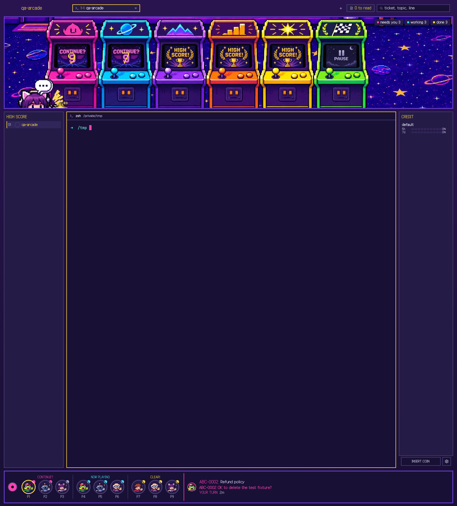

# Arcade Cards

An 80s arcade at night, cut as the front of one cabinet. A marquee bar across the top names the
space, numbers its tabs as stages and holds the search field. Below it, six lit cabinets stand in
the dark; one character per session plays, waits, cheers or sleeps, and everybody else watches
from the floor. The middle row is the cabinet's screen face: a HIGH SCORE board on the left, a
square CRT in the centre and a CREDIT panel on the right with each account's usage and a coin slot
under it. The bottom is the control panel: a joystick, one round button per session with its
character, P number and status lamp, and the selected session's line of dialogue.



## What you see

Top to bottom, one cabinet on a ground that runs from the cabinet's purple `cab` `#2a1450` into the
dark room `canvas` `#191035` (180° gradient, 10 px between rows):

1. **Marquee bar** — 40 px, `cab` fill, window-drag. Left: the space name (180 px). Middle: the
   tabs, each `1-1`, `1-2`, … in Galmuri14, the active one on `#251b47` with a 2 px `#f9d544`
   border. Right (380 px): the branch chip, the "N to read" page chip and a search field on
   `#191035` with a 2 px `#483e74` border (`#f9d544` when it has the keyboard).
2. **Marquee** — 340 px at load, 240–480 px, its lower edge is the only drag boundary. The arcade
   art fills the width: six cabinets in magenta, cyan, purple, orange, yellow and green, mounted at
   3 px `cabEdge` `#6b3fd1`, each with a lit screen and one character in front. Three filter chips
   sit in the top-right corner: a magenta dot and "needs you N", a cyan dot and "working N", a
   yellow dot and "done N".
3. **Middle row** — 10 px gaps. **HIGH SCORE**: 220 px, `#251b47` card with a 2 px `#483e74`
   border, a yellow `HIGH SCORE` heading in Galmuri14, then each repository's name as a heading
   and one 30 px row per space — rank `01`, a 16 px face or a dashed placeholder, the ticket key in
   white and the space name in `#d0cdea`. **CRT**: the centre, square, background `#191035`, a
   2 px `#483e74` border (a 2 px `#f9d544` ring while focused), a 30 px pane header with the agent
   and its folder, then the terminal. **CREDIT**: 200 px, the same `#251b47` card; a yellow
   `CREDIT` heading, one row per account — the label, two rows of ten pips for that account's
   rate-limit windows with the percentage, and `this pane` on the account the focused Claude Code
   pane runs under. Under the card: a dark `#191035` coin slot reading `INSERT COIN` in Galmuri11,
   and a 32 px settings button beside it.
4. **Control panel** — 120 px, `#191035` inside a 3 px `#6b3fd1` border. A 34 px magenta
   `#ff41b4` joystick with a dark cap, then one button per session: a 52 px circle with a 32 px
   face, `P1`, `P2`, … under it and a 12 px lamp at the top-right. Groups run CONTINUE?, NOW
   PLAYING, CLEAR! left to right, separated by 2 px dashed rules. The rest is the selected
   session's info area — a face, the ticket key in the mood colour, the topic, two lines of
   dialogue and the state and elapsed time, against a 2 px mood edge. The selected button takes a
   3 px `#f9d544` ring.

Body type is Galmuri11, display type Galmuri14.

## How it behaves

Every session is one of five moods, read from the cards' scan:

| Mood | In the arcade | The panel and the rest |
| --- | --- | --- |
| working | Stands with its back to you at its machine (`y` 700). The screen loops the play art at 85–100 % opacity. | NOW PLAYING, cyan `#3adaf2` lamp and word. |
| needs (blocked, waiting for you) | Steps out to `y` 800 in the alert pose. The screen blinks the CONTINUE? art, magenta, and a yellow digit counts 9 → 0 each second over it. A `!` bubble leads its line, always visible, cut at 16 characters. | CONTINUE?, magenta `#ff41b4` lamp blinking, magenta word. |
| stall | Stays at its machine with its back turned, and the screen shows the static PAUSE art. Its line shows only while the pointer is on it, cut at 12 characters. | CONTINUE?, grey `#d0cdea`. |
| done | Cheers at `y` 720 with a pulsing sparkle over its head and the HIGH SCORE screen lit. | CLEAR!, yellow `#f9d544` lamp. |
| viewed (read already) | Sleeps on the back bench (three spots), then on the floor in front of it (three more), with a zzz that floats up and fades. | CLEAR!, lamp at 35 % opacity. |

A machine with no session shows the demo screen at 70 % opacity. A seventh session and later do
not get a machine: they watch from the right-hand floor, then the gaps between the right machines,
in rows towards the viewer.

**What moves.** A session that appears after the first scan walks in from the doorway at design
(105, 380), down to the aisle at `y` 760, across and up to its place. A mood change walks it to the
new mood's spot the same way; a character keeps its machine. The needs countdown, the blinking
screens and lamps, the zzz, the sparkle and the `!` are all read from the clock at render, so a
timer that never fires still shows the right frame.

**Pointer.** Click a character to focus the pane its card would focus. Drag one: after 4 px of
travel it lifts 28 px and follows the pointer; released, it lands inside x 40–1490, y 420–860 with
a 220 ms squash, then stands there for 8 seconds before walking back to its own place. While it
stands there it can be dragged again, and a mood change sends it to the new place immediately.
Hover a character for its line; `Needs you` speaks without the pointer.

**The scene's keyboard.** The stage takes ←→ to move the highlight and ↩ or Space to open the
highlighted character; the chip row takes ←→ and ↩ or Space to toggle a filter. Clicking a chip
filters the scene by mood group; a hidden character dims to 15 %.

**The side panels.** Click a HIGH SCORE row to select its space (and its Slack thread tab);
right-click opens the space menu; ↑↓ and ↩ work while the board has the keyboard. Click a CREDIT
row to open the accounts popup (the same one `ctrl-shift-a` opens). The coin slot starts a new
space, exactly like the old `+` button, and lights yellow under the pointer; the gear opens
settings. The joystick is decoration and does not click.

**The control panel.** Clicking a P button focuses that session (or runs its own jump); hovering
one raises the full card above it. ←→ move the selection and wrap, ↩ opens it, ⌫ dismisses,
Space jumps to the waiting session, ⇧Space to the oldest done one, ⌘↩ opens links, Esc steps back
and `?` shows the HOW TO PLAY legend. `ctrl-alt-p` hands the keyboard to the panel and back.

**The marquee bar and tabs.** Dragging the empty part of the bar moves the window. Tabs select on
click, rename on double-click and move on drag; the branch chip and the page chip open their lists
and the search field takes the typing.

## Built from

`layouts/arcade.json`:

```json
root: column, theme "arcade", gradient cab→canvas 180°,
      padding [10, 14], gap 10, titlebar "none", traffic_lights [12, 16], resizable false
  marquee-bar: row, px 40, bg "cab", padding [0, 12], gap 8, window_drag true
    lights-room: column, px 44, window_drag true   (room for the macOS window buttons)
    cards-title: block, px 180                -> arcade-cards {role: "head"}
    tabs:        block, min 120               -> arcade-tabs
    cards-tools: block, px 380                -> arcade-cards {role: "tools"}
  cab-top: column, gap 10, resizable true
    marquee: block, px 340, min 240, max 480, border 3 cabEdge, radius 0
             -> arcade-scene {frame: "marquee"}
    mid: row, gap 10, resizable false
      high-score-panel: column, px 220, resizable false
        high-score: block                     -> arcade-rail {variant: "board"}
      main: block, tab "active", radius 0
        pane: bg "background", radius 0, border {2, "border"}, focus {2, "accent"},
              gap 8, lone true,
              header {mod: "arcade-pane", height: 30, position: "top", reveal: "always"}
      credit-panel: column, px 200
        credit:       block                   -> arcade-accounts {role: "board"}
        rail-buttons: block, px 44            -> arcade-rail {role: "buttons"}
  panel: block, px 120                        -> arcade-cards {role: "panel"}
```

**arcade-cards props.** Besides `role`, the blocks take four optional props. `jiraBase`
(`https://example.atlassian.net/browse/`) and `slackBase` (`https://example.slack.com/archives/`)
prefix the ticket and Slack-thread links in a card's menu; with either empty (the default) that row
and its hot key are not offered and ticket keys show as plain text. `knownRepos` (default `[]`)
lists repository prefixes matched against `<repo>-…` folder names when the path has no `workspaces/`
or `.claude/worktrees/` segment. `ticketPrefixes` (default `[]`) lists the Jira project prefixes
such as `["ABC"]`: those keys then match case-insensitively (`abc-1408-ai` is `ABC-1408`) and only
those prefixes match. With it empty a key must be uppercase Jira-style (`ABC-12`), so `worker-2` is
not one. `arcade-rail` reads the same prop from its own blocks.

`themes/arcade.json` adds `cab` `#2a1450` and `cabEdge` `#6b3fd1`; the rest is the arcade palette
(`background/canvas #191035`, `chrome/surface #251b47`, `border #483e74`, `accent #f9d544`,
`blocked #ff41b4`, `working #3adaf2`, `done #f9d544`).

**arcade-cards** is the data and the control panel. It runs
`sh mods/arcade-cards/scan.sh` every 3 s and publishes `shared("arcade-cards")`: the cast — one
entry per visible session with its character, mood, topic and focus target — plus `places` for the
rail. `castOf` maps the scan's buckets to the five moods. Roles: `head` (space name), `tools`
(branch chip, unread page chip, search), `panel` (joystick, session buttons, info area, hover
popover, legend), `cards` (the horizontal strip, kept for other layouts), `links` (the card menu).
Icon assets come from the shipped `mods/workspace-chrome/` and `mods/pane/` mods.

**arcade-scene** draws the cast from `shared("arcade-cards")` and the mood filter from
`shared("arcade-filter")`. `assignSpots` places each session (six machines, three bench spots,
three floor spots, then spectator rows); `waypoints`/`walkLegs`/`walkAt` are the walk;
`screenFor` picks the machine art. Clicking a character runs `pane.focus` with the card's target.

**arcade-rail** publishes the two side blocks. `variant: "board"` (`role` default `spaces` unused
here) draws HIGH SCORE from `spaces()`/`agents()`: a row per space grouped by the repository its
terminal's current directory belongs to, clicked with `space.select` + `tab.select`, right-click
opens the shipped `menu` overlay. `role: "buttons"` draws the coin slot (`space.new`) and the
settings button (`app.settings`).

**arcade-accounts** draws the CREDIT board. It runs `sh mods/arcade-accounts/cca --porcelain
[pid]` every 30 s for the focused Claude Code pane and every account under
`~/.claude-accounts`; `cardWindows` gives each account's two windows (5h/7d, or 7d/Fable on an
Ultra plan), and `windowText` formats them. A row click opens the accounts popup, the same overlay
as `mod.open:arcade-accounts`; the popup can add accounts, add models and resume a session under
another account. The shell work and the account files live in `cca`; it also asks the Anthropic
usage endpoint at most every 5 minutes for the Fable weekly window.

**arcade-tabs** is the shipped tab bar with stage numbers: it reads the layout and space state,
remembers each space's side panel in localStorage, and runs the tab, layout and window commands.
**arcade-pane** is the 30 px CRT header. **arcade-editor** is not placed by this layout.

**Keys** (`layouts/arcade.keys.json`, merged into `keys.json` by the installer):
`ctrl-alt-p` → `arcade-cards.toggle`, `ctrl-shift-a` → `mod.open:arcade-accounts`,
`cmd-=`/`cmd-+` → `arcade-cards.font_in`, `cmd--` → `font_out`, `cmd-0` → `font_reset`,
`cmd-[` → `back`, `cmd-]` → `forward`.

**Art.** `mods/arcade-scene/art/*.webp` holds the room, the six cabinets, five screen stills, the
character poses, shadows, glow and the `!`/sparkle/zzz/dots marks. The characters' 256 px sprites
and 64 px faces ship in `mods/arcade-cards/chars/` and `mods/arcade-rail/faces/`; Galmuri11 and
Galmuri14 ship with the mods.

## Watch out

- The scene must stay square: the marquee and the CRT have radius 0, the CRT's block has no
  background of its own, and the scene uses no corner masks. Round corners are reserved for the
  cabinet's own buttons (the joystick, the P buttons, the faces).
- The marquee crops the characters' bodies at the chest and draws no speech bubbles; the same line
  lives in the control panel's info area. The marquee fit is a width fit only: scale `W / 1456`,
  top `-332 × scale`; it must not add side bands.
- Six machines are hard limits. Viewed sessions use three bench and three floor spots before the
  spill positions; spectators fill five x positions per row at `y` 810 and 860. Count the cast
  before assuming a spot exists.
- The control panel has no `VirtualList` and ignores its measured size: hover cards render at
  `k = 1`, and the panel does not scale.
- A drop lands only inside x 40–1490, y 420–860, sits for 8 s and then walks home; the walk is
  time-read, so do not add a timer-only stage.
- The installer merges the key section into `keys.json`; edits there stay in the user's file.
  `arcade-cards` runs `scan.sh` every 3 s and reads `~/.claude`, `~/.claude-accounts`, Codex and
  Gemini session folders, `/tmp/deadhd-state`, `~/.pulse/pages` and the session processes; it also
  runs `tmux`, `open` and the Orca CLI on clicks. `arcade-accounts` runs `cca` every 30 s, writes
  under `~/.claude-accounts` and `~/.codex-accounts`, and makes the usage request above.
  `arcade-rail` runs `git -C <cwd> rev-parse …` every 30 s for each distinct cwd.
- The joystick is decorative. Nothing else in this layout is a control that does nothing.

## Done when

- `node --import ./tests/stubs/register.mjs --test tests/` is green. The suite proves, among other
  things: the layout tree and its 10 px gaps; the square, `border`-edged CRT; the coin slot and
  settings block inside `credit-panel`; the six-machine placement and the bench/floor/spectator
  overflow; the needs countdown and screen art per mood; the 4 px drag slop and the drop box; and
  a dropped character holding for `RETURN_MS` then walking home on the clock with no timer firing.
- `HERDR_APP_HOME=/tmp/harc ./tools/install.sh` prints `check passed` for all seven mods
  (`arcade-cards`, `arcade-scene`, `arcade-rail`, `arcade-accounts`, `arcade-tabs`, `arcade-pane`,
  `arcade-editor`).
- `layout.switch {name: "arcade"}` shows the window above; `ctrl-shift-l` switches back.
